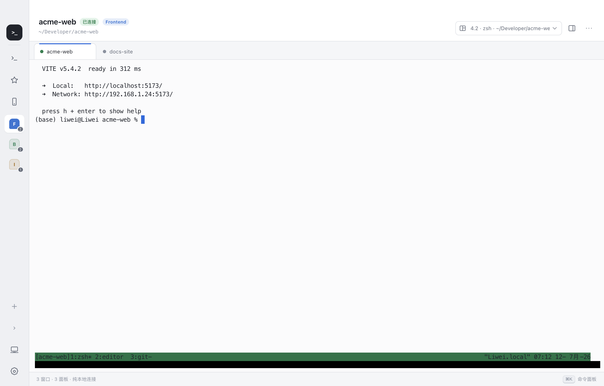
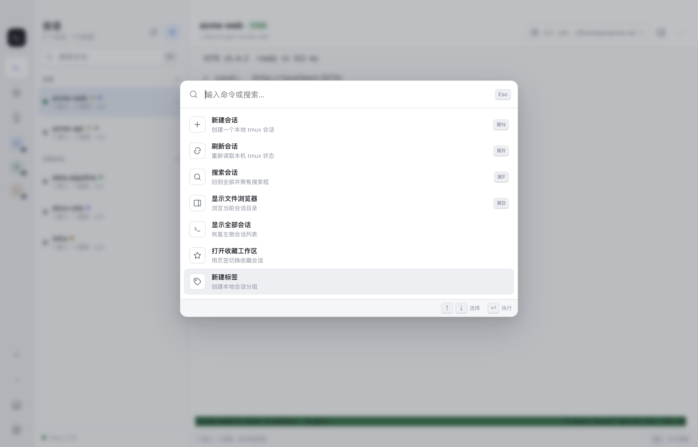
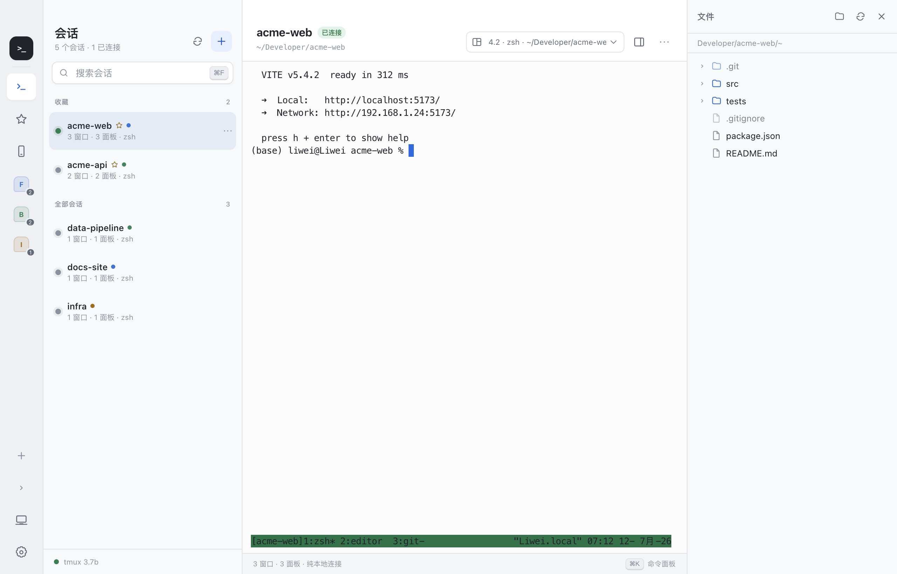
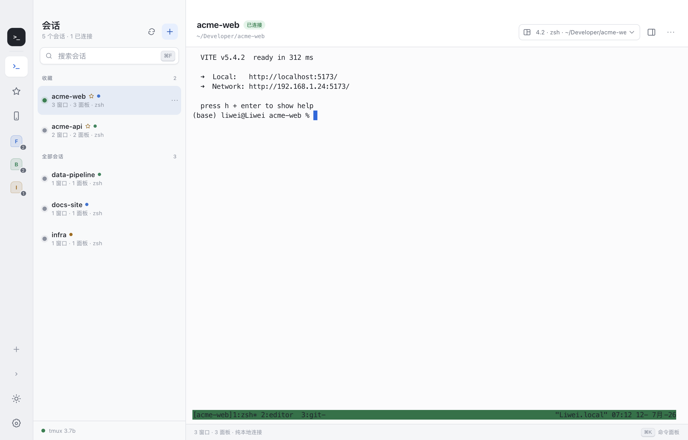
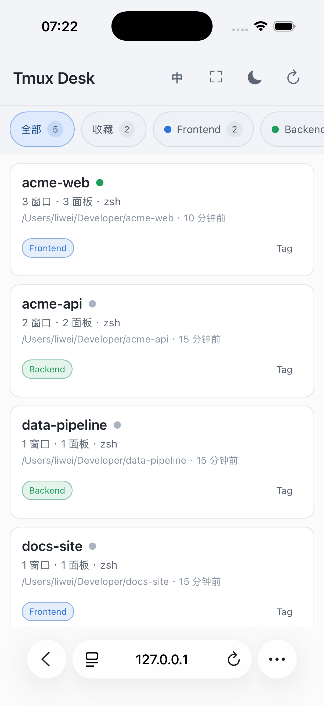
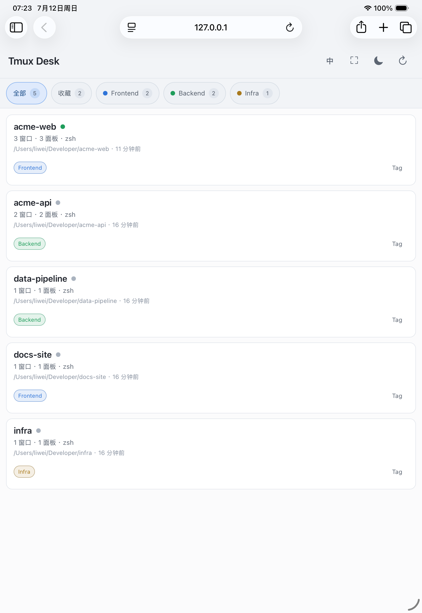
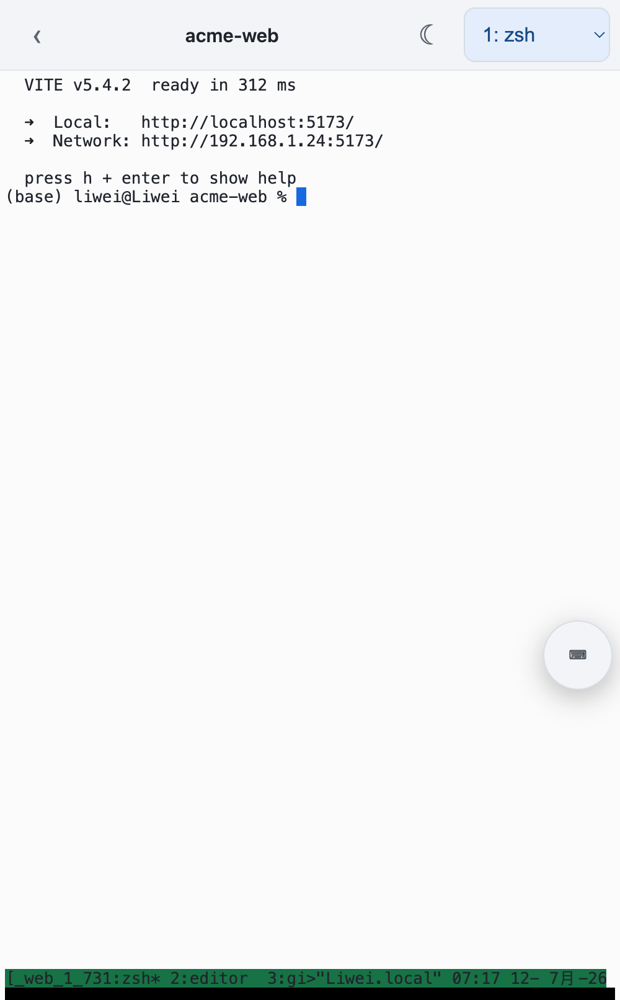
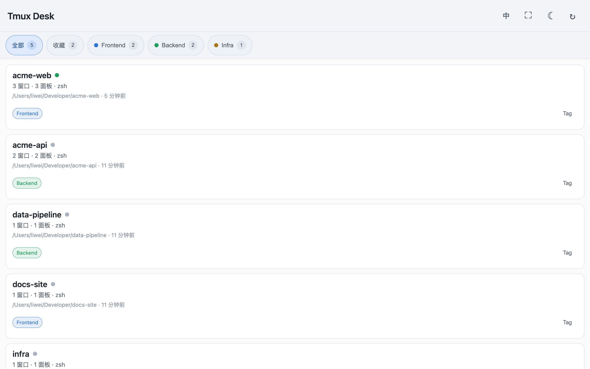

# Tmux Desk

[简体中文](README.md) · **English**

Tmux Desk is a local-first desktop manager for tmux. It uses a workbench-style layout to bring your local tmux sessions, windows, panes, and real terminals into a single desktop window — with optional phone / tablet web access. macOS first, Windows (via WSL) supported.

Under the hood it's Electron + [xterm.js](https://xtermjs.org/) + [node-pty](https://github.com/microsoft/node-pty): the control plane shells out to `tmux`, and the terminal plane attaches your local tmux panes — so **your `~/.tmux.conf` applies verbatim**.

## Screenshots

> The screenshots below use sandbox sessions and fictitious projects (acme-web / acme-api …). No real data.

| Desktop workbench | Tag groups & tabs |
|:---:|:---:|
|  |  |
| **Command palette (⌘K)** | **File browser (⌘B)** |
|  |  |

Dark theme (system-following also supported):



### Phone / Tablet / Browser

Any phone browser can drive all of your local tmux sessions; add it to the home screen to use it like an app.

| iPhone (session list) | iPad (session list) |
|:---:|:---:|
|  |  |

| Phone full-screen terminal | Desktop browser |
|:---:|:---:|
|  |  |

## Features

- View, search, create, attach, favorite, rename and close local tmux sessions
- Assign multiple local **Tags** to a session and enter a dedicated workspace per Tag from the left rail
- The Tag rail fills available height and sorts by recent use; expand the column for full names, drag the right edge to resize, recently-used floats to the top with a smooth transition; **pin** frequently-used Tags to fix their order
- Tag and Favorites workspaces collapse the middle session column and group same-tag sessions into a row of browser-style tabs; no duplicates within a Tag
- The "All" view's session sidebar is drag-resizable (double-click the divider to reset); Tag / Favorites compact views still collapse it fully
- **Duplicate session** (like `git checkout -b`): derive a copy from an existing session's windows and directory, leaving the original untouched
- **Split panes** (`⌘D` vertical / `⌘⇧D` horizontal, `tmux split-window`) and **close/restore split**; each split has an × overlay button in its top-right corner
- **File browser on the right** (`⌘B` to toggle): browse the file tree of the current session's directory — open with default app, "Open With…" another app, reveal in Finder, copy path
- Pane picker in the workspace header for quick pane focus; `⌘1…9` switches the current session's tmux window
- Full interactive terminal via xterm.js + node-pty, with color, mouse and full-screen TUI programs
- `⌘K` command palette and familiar desktop shortcuts
- Light, dark and system-following themes; defaults to light on first launch
- Bilingual UI (English / Chinese; system-following or manual)
- Auto-refresh after sessions are created or closed in an external Terminal
- No login, telemetry, cloud sync or plugins; the phone web service is off by default and only listens on the network after you start it

## Using Tags

1. Click `+` below the Tag area in the left rail to create a Tag.
2. In any session's `…` menu choose "Manage Tags…" to check multiple Tags at once.
3. Clicking a Tag in the left rail collapses the middle session list; that Tag's sessions appear as a row of tabs above the terminal.
4. Click the expand button to show full Tag names; drag the right edge to resize, double-click to reset. The most recently opened Tag smoothly floats to the top and persists across restarts; **pin** a Tag if you don't want it to move.
5. Click "All Sessions" to restore the full list. The settings page can create, rename and delete Tags; deleting a Tag never closes tmux sessions.

Tags, favorites, theme and window size are stored only on this machine. Duplicating a session inherits the source session's Tags; renaming a session migrates its Tag associations.

## ⚠️ tmux behavior vs App behavior (important)

Tmux Desk's terminal *is* your local tmux, and it **reads `~/.tmux.conf` as usual** when it attaches. So a lot of "App behavior" is actually decided by your **tmux config** — swap in a different tmux config elsewhere and the behavior changes. These are the common "I thought it was the App, but it's tmux" points (config examples mirror this project author's `~/.tmux.conf`):

| What you see | Actually decided by | Relevant tmux config |
|---|---|---|
| Mouse wheel scrolls history, drag-to-select works in the terminal | tmux | `set -g mouse on` |
| How many lines you can scroll back | tmux | `set -g history-limit 50000` |
| **Shift+Enter inserts a newline** (isn't swallowed) in some TUI / REPL programs | tmux + terminal features | `set -s extended-keys on` / `set -as terminal-features 'xterm*:extkeys'` |
| `⌘1…9` window numbers start at **1**; numbers renumber after you close a window | tmux | `set -g base-index 1` / `setw -g pane-base-index 1` / `set -g renumber-windows on` (tmux defaults to 0-based, no renumber) |
| Closing the **last pane** of a session doesn't exit tmux but switches to another session | tmux | `set -g detach-on-destroy off` |
| Releasing a mouse drag copies to the system clipboard | tmux (this path) | e.g. `bind -T copy-mode MouseDragEnd1Pane send-keys -X copy-pipe-no-clear "pbcopy"` |
| `prefix + T/L/X` pops up an fzf session picker etc. | tmux (your bindings, e.g. `sesh`) | `bind-key T display-popup …` |
| The color/content of that bottom status bar | tmux | the `status-*` options — tmux draws it, not the App |
| Whether true color (24-bit) works | tmux + terminal features | `terminal-features 'xterm*:RGB'` (the App already declares `RGB` on attach) |

The App only **forwards keys**, **attaches panes**, and layers its own desktop interactions on top (only the `⌘`-prefixed entries in the Shortcuts table below are App shortcuts). Therefore:

- **The prefix key is still tmux's prefix (default `⌃B`)**, which is a different thing from the App's `⌘B` (toggle file browser). To send tmux commands inside the App, press your prefix as usual.
- The App's "select-to-copy" goes through the xterm selection + OSC 52 path (see Privacy below), which is independent from your tmux `copy-pipe` binding — both may fire.
- If a behavior differs between the App and another terminal, **suspect a tmux config difference first** (prefix, `mouse`, `base-index`, …), not an App bug.

> For cross-environment consistency, the App does two things on attach: declares OSC 52 clipboard + true color support via `tmux -T clipboard,RGB attach-session`; and forces a UTF-8 locale (`LANG`/`LC_ALL`) for the tmux child, so launching from Finder/Dock doesn't fall back to the C locale and render CJK/emoji session names as `_`.

## Keyboard shortcuts

All of the following are **App shortcuts** (tmux's own prefix bindings are unaffected — see the section above).

| Shortcut | Action |
|---|---|
| `⌘K` | Open command palette |
| `⌘N` | New session |
| `⌘F` | Search sessions |
| `⌘R` | Refresh sessions |
| `⌘B` | Toggle file browser |
| `⌘D` / `⌘⇧D` | Split vertically / horizontally (`tmux split-window`) |
| `⌘⇧T` | Cycle light / dark / system theme |
| `⌘1…9` | Switch the current session's tmux window |
| `⌘←/→` | Switch to the adjacent session tab within the current Tag/Favorites workspace (like iTerm) |
| `⌘⇧←/→` | Move the current session tab within the manual order |
| `⌘↑/↓` | **Switch between Tags** (jumps to the target Tag's first session; does not trigger the recency re-sort of unpinned Tags) |
| `Esc` | Close menu or dialog |

## Requirements

- macOS (Apple Silicon first; x64/universal packaging scripts retained) or Windows 10/11 + WSL2
- Node.js 22+ (only needed to run from source / package)
- macOS: Xcode Command Line Tools (to compile the `node-pty` native module)
- tmux:

```bash
brew install tmux          # macOS
sudo apt install tmux      # WSL / Linux
```

On macOS the app probes, in order: a **bundled tmux** (`Contents/Resources/bin/tmux` inside the `.app`), `/opt/homebrew/bin/tmux`, `/usr/local/bin/tmux`, `/usr/bin/tmux`, then PATH.

> **Pre-bundle tmux for users who don't have it**: drop an executable tmux binary at `vendor/bin/tmux` before packaging and the app ships tmux, ready out of the box (see `vendor/README.md`). `vendor/bin` is empty by default, and the app falls back to system tmux.

## Download & install

Grab the artifact for your platform from [Releases](https://github.com/HeavenC/Tmux-Desk/releases):

| Platform | Artifact |
|---|---|
| macOS · Apple Silicon | `Tmux Desk-<version>-arm64.dmg` |
| macOS · Intel | `Tmux Desk-<version>-x64.dmg` |
| Windows | `Tmux Desk Setup <version>.exe` (NSIS installer) |

> macOS artifacts are **ad-hoc signed and not notarized**. If first launch warns "cannot verify developer", **right-click the App → Open**, or run `xattr -cr "/Applications/Tmux Desk.app"`. Always distribute the `.dmg` — do not send a bare `.app` over chat/email (it breaks symlinks inside the Electron framework and yields a "damaged" error). tmux must be installed on the machine to run.

## Windows (WSL)

Windows has no native tmux, so Tmux Desk runs tmux through **WSL**: the desktop side is still a Windows Electron app, but every tmux control command and terminal attach runs inside WSL as `wsl.exe -e tmux …`, and session/window/pane working directories are WSL-side paths.

> **In one sentence**: Tmux Desk is the "window + interaction"; tmux is the "session engine running in the background." Windows has no tmux, so the engine runs inside WSL (a lightweight Linux on Windows) and Tmux Desk just displays it. So the order is **WSL first, then tmux, then Tmux Desk**.

### From scratch (new users — 4 steps)

**Step 1 · Install WSL2**

If you've never used WSL, open **PowerShell as administrator** (Start menu → search "PowerShell" → right-click → Run as administrator) and run:

```powershell
wsl --install
```

This single command enables the WSL feature, installs WSL2, and installs the default distro **Ubuntu**. **Reboot** when it finishes.

> Works on Windows 11 and recent Windows 10 (2004+). If it says `wsl` is not recognized, your system is too old — see "Manual install on older Windows" below.

**Step 2 · Set up Ubuntu**

After rebooting, **Ubuntu** appears in the Start menu — open it. On first launch it asks you to create a **Linux username and password** (unrelated to your Windows account; just remember it — the password stays hidden while typing, which is normal). You're done once you see the shell prompt (like `you@pc:~$`).

**Step 3 · Install tmux inside Ubuntu**

In that Ubuntu window, run line by line (the first asks for the password from Step 2):

```bash
sudo apt update
sudo apt install -y tmux
tmux -V          # prints a tmux version number → installed
```

**Step 4 · Install and launch Tmux Desk**

Download `Tmux Desk Setup <version>.exe` from [Releases](https://github.com/HeavenC/Tmux-Desk/releases), double-click to install, then launch it. The app finds tmux through WSL automatically; if it doesn't right after install, click **"Re-detect"** in the UI.

You can now create sessions, open windows, and split panes. When creating a session, the working directory can be a Windows drive (`/mnt/c/...` in tmux) or a native WSL path (`/home/your-username/...`).

### Manual install on older Windows

If `wsl --install` isn't available (older Windows 10), run in an admin PowerShell:

```powershell
dism.exe /online /enable-feature /featurename:Microsoft-Windows-Subsystem-Linux /all /norestart
dism.exe /online /enable-feature /featurename:VirtualMachinePlatform /all /norestart
```

Reboot, install the [WSL2 Linux kernel update package](https://aka.ms/wsl2kernel), then run:

```powershell
wsl --set-default-version 2
```

Finally install **Ubuntu** from the **Microsoft Store** (or `wsl --install -d Ubuntu`), then return to Step 2 above.

### Troubleshooting

- **App says tmux not found**: confirm `tmux -V` prints something inside WSL; if it still fails, click "Re-detect" or restart the app.
- **Multiple distros / wrong default**: pin it with the `TMUX_DESK_WSL_DISTRO` env var (see table); list distro names with `wsl -l -q`.
- **tmux not on the default PATH (e.g. self-compiled)**: set `TMUX_DESK_WSL_TMUX` to the absolute path of tmux inside WSL.

**Optional environment variables**

| Variable | Purpose |
|---|---|
| `TMUX_DESK_WSL_DISTRO` | Which WSL distro to use (maps to `wsl -d <distro>`). Unset → the default distro |
| `TMUX_DESK_WSL_TMUX` | The tmux command or absolute path inside WSL (default `tmux`) |

**Path handling**: both directories under Windows drives (shown in tmux as `/mnt/c/...`) and native WSL directories (`/home/...`, accessed via `\\wsl$\<distro>\...` UNC) can host sessions and be browsed. The file browser needs the distro name to reach native WSL paths — it auto-detects the first distro from `wsl -l -q`, or pin it with `TMUX_DESK_WSL_DISTRO`.

> No Windows icon is bundled yet; for branding, drop a 256×256 `build/icon.ico` before packaging.

## Run from source

```bash
git clone https://github.com/HeavenC/Tmux-Desk.git
cd Tmux-Desk
npm install
npm start
```

`npm install` uses Electron Builder to rebuild the `node-pty` native module for the current Electron version.

## Phone / Web access

Any phone/tablet browser can drive all of your local tmux sessions (pair it with [Tailscale](https://tailscale.com/) for remote access — its WireGuard tunnel provides transport security; the service itself does not do TLS). Two ways to start it:

- **Inside the desktop app**: the phone icon in the left rail (or "Phone access" in the command palette) → "Start web service", which shows Tailscale and LAN QR codes to scan. The service stops when the app quits.
- **Command-line daemon** (works without the app):

```bash
npm run serve:web     # builds the phone page and starts it, default port 8790
```

It prints access URLs per interface (with a random token, persisted at `~/.config/tmux-desk/web-token`). Open `http://<Tailscale IP>:8790/?token=<token>` on your phone and add it to the home screen.

- Session list → tap to enter a full-screen terminal (xterm.js), with Esc / Tab / Ctrl (sticky) / ⌃B / arrow assist keys at the bottom
- The top of the list switches between "All / Favorites / each Tag"; sessions are de-duplicated by name within a Tag, session cards show multiple Tags, and associations can be edited from the bottom sheet
- The phone page supports an independent light/dark theme (persisted per device), touch scrolling, notch safe areas, orientation and dynamic virtual-keyboard height
- The phone attaches a **session-group derivative** (`_web_*`) that mirrors the desktop content but keeps its own current window and size; it is cleaned up on disconnect
- Environment variables: `TMUX_DESK_WEB_PORT`, `TMUX_DESK_WEB_HOST`, `TMUX_DESK_WEB_TOKEN`, `TMUX_DESK_PREFERENCES_FILE`

The web service authenticates with the random token in the URL but provides no TLS. Prefer Tailscale; LAN URLs are only for trusted Wi-Fi — **never expose port 8790 directly to the public internet**. A full URL with token is equivalent to an access credential; don't forward it.

## Advanced environment variables

| Variable | Purpose |
|---|---|
| `TMUX_DESK_SOCKET` | Run all tmux commands against a dedicated socket (`tmux -L <name>`) instead of the default one. Useful for **demos / screenshots / testing** — it never touches your real sessions. Empty → default socket. |
| `TMUX_DESK_PREFERENCES_FILE` | Override the preferences file path (theme, favorites, Tags, window size, …), so a demo/test instance stays isolated from your everyday config. |

## Tests

```bash
npm test
npm run test:integration
npm run build
```

Integration tests use an isolated `tmux -L tmux-desk-test-*` socket and never attach to, modify or close your existing tmux sessions.

## Packaging / building installers

### Easiest: one script (macOS)

```bash
cd Tmux-Desk
./build.sh            # DMG for the current Mac arch (Apple Silicon→arm64, Intel→x64)
./build.sh intel      # force Intel (x64)
./build.sh universal  # universal binary (arm64+x64, larger)
./build.sh all        # both arm64 and x64
```

The script checks the environment, installs deps (rebuilding `node-pty` for Electron), packages, and produces `Tmux Desk-<version>-<arch>.dmg` and `.zip` under `dist/`.

### Per-platform CI release (GitHub Actions)

Pushing a `v*` tag (e.g. `git tag v0.4.0 && git push --tags`) triggers [`.github/workflows/release.yml`](.github/workflows/release.yml), which builds **mac arm64 / mac x64 / Windows NSIS** on macOS and Windows runners and attaches the artifacts to the matching GitHub Release. This is the recommended way to get a **working Windows installer** — the native `node-pty` must be compiled on Windows and can't be cross-produced on a Mac.

### Manual equivalents (macOS)

```bash
npm install                                                     # deps + rebuild node-pty
CSC_IDENTITY_AUTO_DISCOVERY=false npm run package:mac           # arm64 DMG + zip
CSC_IDENTITY_AUTO_DISCOVERY=false npm run package:mac:x64       # Intel
```

Artifacts are **ad-hoc signed** (`codesign --sign -`, see `scripts/afterpack-adhoc.js`) but not notarized. For a real release, configure Developer ID signing and Apple notarization via Electron Builder environment variables — never commit certificates or credentials.

## Local data & privacy

Desktop mode never sends terminal input, output or tmux session data over the network. Once you start the phone web service, terminal data streams in real time between this machine and the token-holding device but is never written to disk; transport encryption is handled by an outer network layer such as Tailscale. Theme, favorites, Tags, Tag-rail expanded state and width, session associations, last session, sidebar width and window size are stored in:

```text
~/Library/Application Support/tmux-desk/preferences.json      # macOS
%APPDATA%\tmux-desk\preferences.json                          # Windows
```

The renderer process has no Node.js access and can only call tmux/terminal operations through allow-listed IPC; control commands use `execFile` argument arrays and never build shell strings.

## FAQ

### The app says tmux isn't found

Run `brew install tmux` (or `sudo apt install tmux` inside WSL), then restart the app or click "Re-detect". The default Apple Silicon Homebrew path is `/opt/homebrew/bin/tmux`.

### node-pty ABI error

The dependency may have been built by a different Node/Electron version. Rerun:

```bash
npm run postinstall
```

### Does switching sessions kill my tasks?

No. Switching only closes the `tmux attach` client for the current window; the tmux server and the processes inside the session keep running. `tmux kill-session` only runs after you explicitly choose "Close session" and confirm.

### Why does some terminal behavior differ from my other terminal?

See the **"tmux behavior vs App behavior"** section above — almost all differences come from `~/.tmux.conf` (prefix, `mouse`, `base-index`, extended keys, …), not the App.

## License

[MIT](LICENSE)
