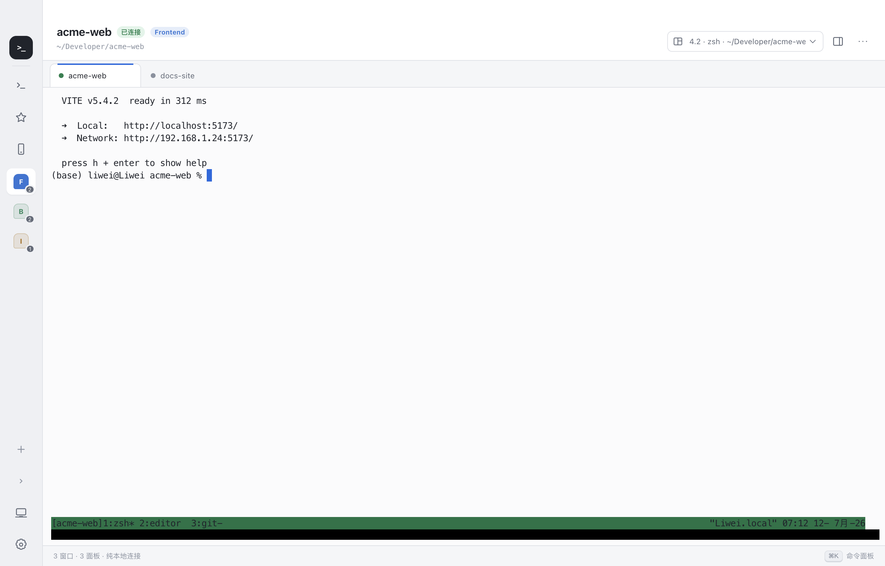
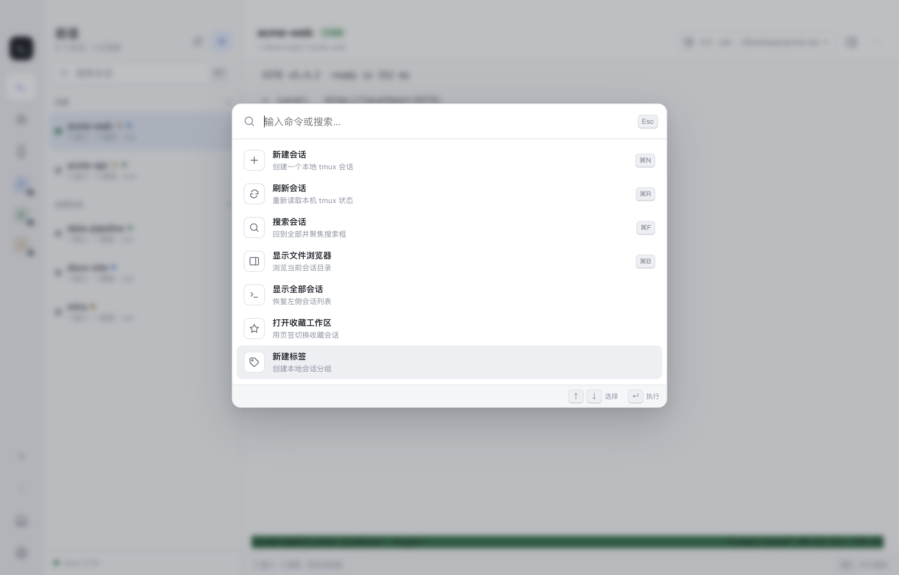
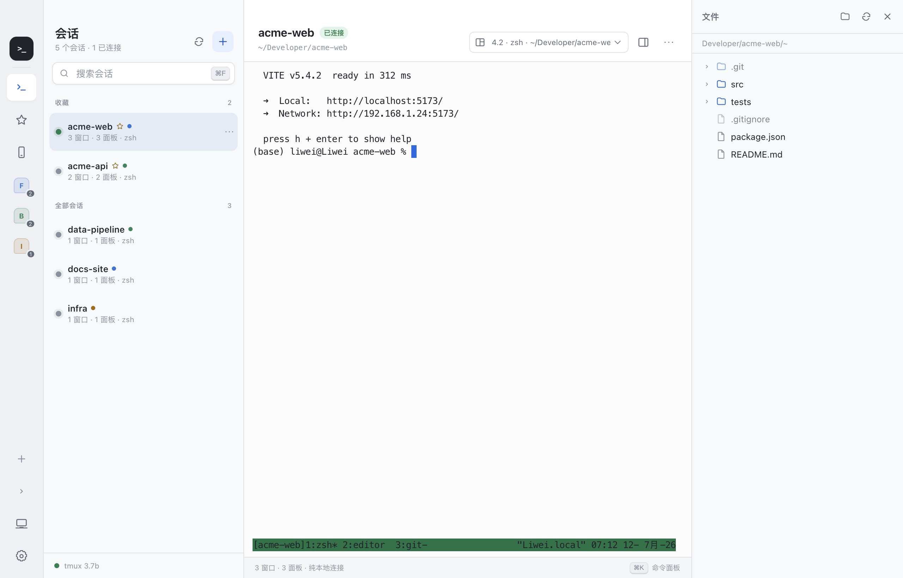
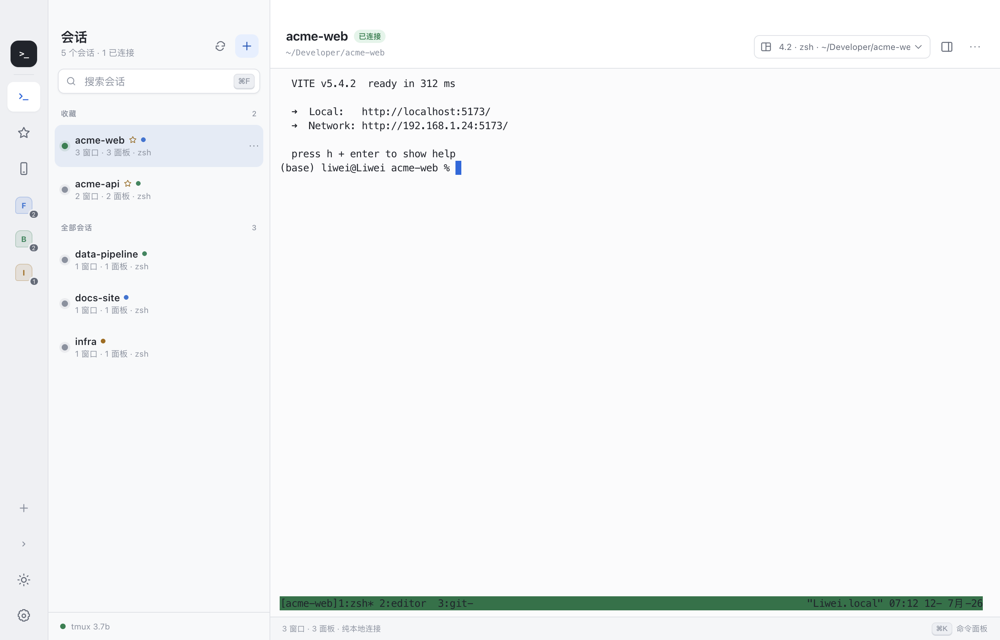
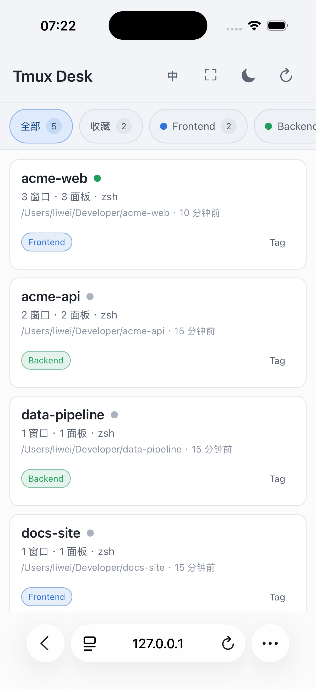
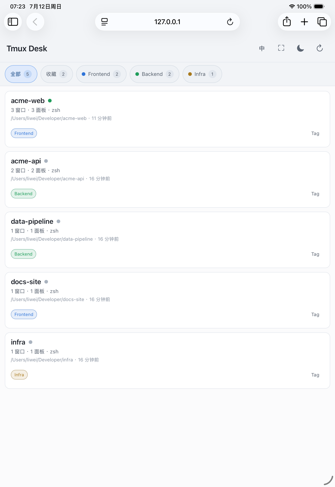
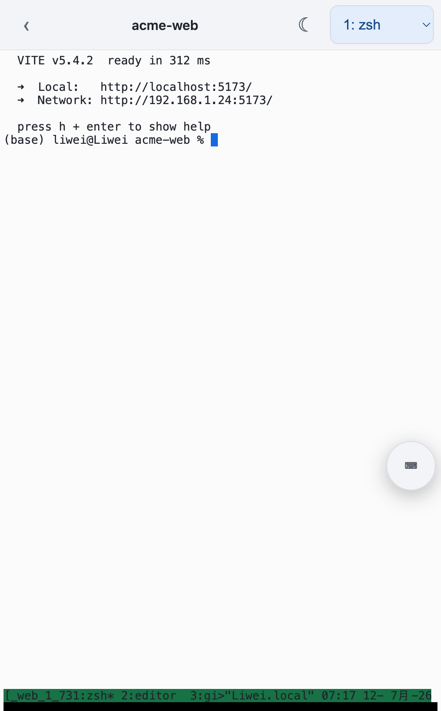
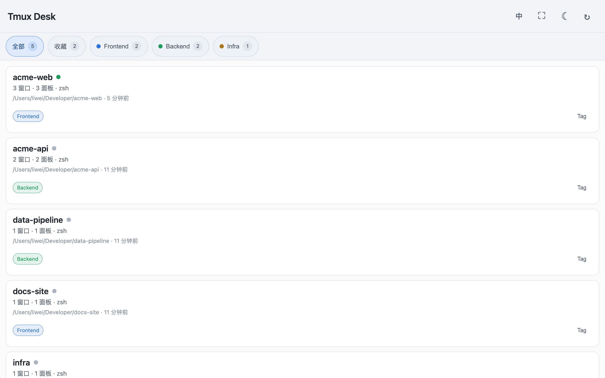

# Tmux Desk

**简体中文** · [English](README.en.md)

Tmux Desk 是一个本地优先的 tmux 桌面管理器。它采用类似工作台的布局，把本机 tmux 会话、窗口、pane 和真实终端集中到一个桌面窗口中，并可按需开启手机 / 平板 Web 接入。macOS 首发，同时支持 Windows（经 WSL）。

底层是 Electron + [xterm.js](https://xtermjs.org/) + [node-pty](https://github.com/microsoft/node-pty)：控制面直接调用 `tmux` 命令，终端面把你本机 tmux 的 pane attach 进来——**你的 `~/.tmux.conf` 原样生效**。

## 界面预览

> 下列截图使用沙箱会话与虚构项目（acme-web / acme-api …），不含任何真实数据。

| 桌面工作台 | 标签分组与页签 |
|:---:|:---:|
|  |  |
| **命令面板（⌘K）** | **文件浏览器（⌘B）** |
|  |  |

暗色主题（亦支持跟随系统）：



### 手机 / 平板 / 浏览器

手机浏览器即可操作本机全部 tmux 会话；加到主屏幕即可当 App 用。

| iPhone（会话列表） | iPad（会话列表） |
|:---:|:---:|
|  |  |

| 手机全屏终端 | 桌面浏览器 |
|:---:|:---:|
|  |  |

## 功能

- 查看、搜索、创建、连接、收藏、重命名和关闭本机 tmux 会话
- 为一个会话分配多个本地 **Tag**，并从左侧功能栏按 Tag 进入独立工作区
- 左侧 Tag 区铺满可用高度并按最近使用排序；可展开整列查看完整名称、拖动右边界调宽，最近使用置顶带平滑过渡；可将常用 Tag **置顶（Pin）**固定顺序
- Tag 与收藏工作区会收起中间会话栏，把同组会话聚合成一排浏览器式页签；同一 Tag 内不会重复
- “全部”视图的会话侧栏可拖动调宽，双击分隔条恢复默认；Tag/收藏紧凑视图仍会完整收起它
- **复制会话**（类似 `git checkout -b`）：按现有会话的窗口与目录派生一个副本，原会话保持不变
- **分屏**（`⌘D` 竖分 / `⌘⇧D` 横分，`tmux split-window`）与**关闭分屏还原**；每个分屏右上角有 × 叠加按钮
- **右侧文件浏览器**（`⌘B` 收起/展开）：按当前会话目录浏览文件树，支持默认应用打开、“打开方式…”选择其他 App、在访达中显示、复制路径
- 像 iTerm 一样按住 `⌘` 点击终端输出中的文件名或路径，以系统默认应用打开；支持相对路径、绝对路径及 `file:line:column` 格式
- 工作区右上角面板菜单快速定位 pane，`⌘1…9` 切换当前会话的 tmux window
- 基于 xterm.js + node-pty 的完整交互终端，支持颜色、鼠标和全屏终端程序
- `⌘K` 命令面板与常用桌面快捷键
- 亮色、暗色和跟随系统主题；首次启动默认亮色
- 中英文界面（跟随系统或手动切换）
- 外部 Terminal 中创建或关闭会话后自动刷新
- 为当前会话生成独立签名 Web 分享链接；服务端把列表、详情、终端连接和窗口切换限制在该会话
- 不含登录、遥测、云同步或插件；手机 Web 服务默认关闭，仅在用户主动启动后监听网络

## 使用 Tag

1. 点击左侧功能栏 Tag 区域下方的 `+` 新建 Tag。
2. 在任一会话右侧 `…` 菜单中选择“管理 Tag…”，可同时勾选多个 Tag。
3. 点击左侧 Tag 后，中间会话列表会收起；该 Tag 下的会话显示为终端上方的一排页签。
4. 点击展开按钮可显示完整 Tag 名称；拖动右边界调整宽度，双击恢复默认。最近打开的 Tag 会平滑移到最上方，并在重启后保持；不希望它移动的 Tag 可以**置顶（Pin）**。
5. 点击“全部会话”恢复完整会话列表。设置页可新建、重命名和删除 Tag；删除 Tag 不会关闭 tmux 会话。

Tag、收藏、主题和窗口尺寸都只保存在本机。复制会话会继承源会话的 Tag；重命名会话时 Tag 关联会同步迁移。

## ⚠️ tmux 行为 vs App 行为（重要）

Tmux Desk 的终端就是你本机的 tmux，attach 时**照常读取 `~/.tmux.conf`**。因此很多“App 的行为”其实是 **tmux 配置**决定的——在别的终端里换一套 tmux 配置，表现就会变。下面这些是常见的“以为是 App、其实是 tmux”的点（配置示例可参考本项目作者的 `~/.tmux.conf`）：

| 现象 | 其实由谁决定 | 相关 tmux 配置 |
|---|---|---|
| 终端里能用鼠标滚轮翻历史、拖动选择 | tmux | `set -g mouse on` |
| 能往回翻多少行 | tmux | `set -g history-limit 50000` |
| 某些 TUI / REPL 程序里 **Shift+Enter 能换行**（不被吞） | tmux + 终端特性 | `set -s extended-keys on` / `set -as terminal-features 'xterm*:extkeys'` |
| `⌘1…9` 对应的 window 编号从 **1** 开始；关掉一个 window 后编号自动重排 | tmux | `set -g base-index 1` / `setw -g pane-base-index 1` / `set -g renumber-windows on`（tmux 默认从 0 开始、不重排） |
| 关掉会话里**最后一个 pane** 时不退出 tmux、而是自动切到别的会话 | tmux | `set -g detach-on-destroy off` |
| 鼠标拖选松开就复制到系统剪贴板 | tmux（这条链路）| `bind -T copy-mode MouseDragEnd1Pane send-keys -X copy-pipe-no-clear "pbcopy"` 之类 |
| `prefix + T/L/X` 弹出 fzf 会话选择器等 | tmux（用户键位，如 `sesh`）| `bind-key T display-popup …` |
| 底部那条状态栏的颜色/内容 | tmux | `status-*` 系列，是 tmux 画的，不是 App |
| 真彩色（24-bit）是否生效 | tmux + 终端特性 | `terminal-features 'xterm*:RGB'`（App attach 时已声明 `RGB`） |

App 只负责**转发按键**、**把 pane attach 进来**、并叠加自己的一层桌面交互（下方“快捷键”表里 `⌘` 开头的才是 App 快捷键）。所以：

- **prefix 键仍是 tmux 的 prefix（默认 `⌃B`）**，和 App 的 `⌘B`（开关文件浏览器）是两回事。想在 App 里发 tmux 命令，照常按你的 prefix。
- App 的“选中即复制”走的是 xterm 选区 + OSC52 链路（见下文隐私说明），和你 tmux 里配的 `copy-pipe` 是两条独立路径，可能同时起效。
- 如果某个行为在 App 里和你另一个终端里不一致，**先怀疑 tmux 配置差异**（prefix、`mouse`、`base-index` 等），而不是 App 的 bug。

> App 侧为保证跨环境一致，attach 时做了两件事：用 `tmux -T clipboard,RGB attach-session` 声明客户端支持 OSC52 剪贴板与真彩色；为 tmux 子进程强制 UTF-8 locale（`LANG`/`LC_ALL`），避免从访达/程序坞启动时继承不到 shell 的 locale 而把中文/emoji 会话名显示成 `_`。

## 快捷键

以下均为 **App 快捷键**（tmux 自身的 prefix 快捷键不受影响，见上一节）。

| 快捷键 | 操作 |
|---|---|
| `⌘K` | 打开命令面板 |
| `⌘N` | 新建会话 |
| `⌘F` | 搜索会话 |
| `⌘R` | 刷新会话 |
| `⌘B` | 收起/展开文件浏览器 |
| `⌘` + 点击文件路径 | 以默认应用打开终端输出中的文件（相对路径基于当前 pane 目录）|
| `⌘D` / `⌘⇧D` | 竖向 / 横向分屏（`tmux split-window`）|
| `⌘⇧T` | 在亮色、暗色、跟随系统之间切换 |
| `⌘1…9` | 切换当前会话的 tmux window |
| `⌘←/→` | 在当前 Tag/收藏工作区内切换相邻会话页签（同 iTerm）|
| `⌘⇧←/→` | 在手动排序中移动当前会话页签 |
| `⌘↑/↓` | **在 Tag 之间切换**（跳到目标 Tag 的第一个会话；不会触发未置顶 Tag 的重新排序）|
| `Esc` | 关闭菜单或对话框 |

## 环境要求

- macOS（首发 Apple Silicon，工程保留 x64/universal 打包脚本）或 Windows 10/11 + WSL2
- Node.js 22+（仅本地运行 / 打包时需要）
- macOS 需 Xcode Command Line Tools（编译 `node-pty` 原生模块用）
- tmux：

```bash
brew install tmux          # macOS
sudo apt install tmux      # WSL / Linux
```

macOS 上应用会依次检测**自带 tmux**（`.app` 内 `Contents/Resources/bin/tmux`）、`/opt/homebrew/bin/tmux`、`/usr/local/bin/tmux`、`/usr/bin/tmux` 和 PATH。

> **给没装 tmux 的用户预打包 tmux**：把一个可执行的 tmux 二进制放到 `vendor/bin/tmux` 再打包，应用即自带 tmux、开箱即用（详见 `vendor/README.md`）。默认 `vendor/bin` 为空，应用回退到本机 tmux。

## 下载安装

到 [Releases](https://github.com/HeavenC/Tmux-Desk/releases) 下载对应平台的产物：

| 平台 | 产物 |
|---|---|
| macOS · Apple Silicon | `Tmux Desk-<版本>-arm64.dmg` |
| macOS · Intel | `Tmux Desk-<版本>-x64.dmg` |
| Windows | `Tmux Desk Setup <版本>.exe`（NSIS 安装包）|

> macOS 产物为 **ad-hoc 签名、未公证**。首次打开若提示“无法验证开发者”，**右键该 App → 打开**，或执行 `xattr -cr "/Applications/Tmux Desk.app"`。务必用 `.dmg` 分发，别把裸 `.app` 通过微信/邮件发出去（会破坏 Electron 框架里的软链接，导致“已损坏”）。运行还需本机装有 tmux。

## Windows（WSL）版本

Windows 上没有原生 tmux，Tmux Desk 通过 **WSL** 运行 tmux：桌面端仍是 Windows 上的 Electron 应用，所有 tmux 控制命令与终端 attach 都以 `wsl.exe -e tmux …` 的形式进入 WSL 执行，会话、window、pane 的工作目录都是 WSL 侧路径。

> **一句话原理**：Tmux Desk 是「窗口 + 交互」，tmux 是「后台的会话引擎」。Windows 没有 tmux，所以引擎跑在 WSL（Windows 里的一个轻量 Linux）里，Tmux Desk 只是把它显示出来。所以**先有 WSL、再有 tmux，最后才装 Tmux Desk**。

### 从零开始（新用户按这 4 步走）

**第 1 步 · 安装 WSL2**

如果你从没用过 WSL，用管理员身份打开 **PowerShell**（开始菜单搜索 “PowerShell” → 右键 → 以管理员身份运行），执行：

```powershell
wsl --install
```

这一条命令会自动：启用 WSL 功能 + 安装 WSL2 + 装好默认发行版 **Ubuntu**。完成后**重启电脑**。

> 适用于 Windows 11 和较新的 Windows 10（2004+）。如果提示 `wsl` 不是可识别的命令，说明系统太旧，见下方「旧版 Windows 手动安装」。

**第 2 步 · 初始化 Ubuntu**

重启后，开始菜单里会出现 **Ubuntu**，点开它。第一次启动会让你设置一个 **Linux 用户名和密码**（和 Windows 账号无关，随便记一个即可，输密码时屏幕不显示是正常的）。看到命令提示符（形如 `你@电脑:~$`）就成功了。

**第 3 步 · 在 Ubuntu 里装 tmux**

在刚打开的 Ubuntu 窗口里，逐行执行（第一行会要你输第 2 步设的密码）：

```bash
sudo apt update
sudo apt install -y tmux
tmux -V          # 能打印出 tmux 版本号就装好了
```

**第 4 步 · 安装并启动 Tmux Desk**

到 [Releases](https://github.com/HeavenC/Tmux-Desk/releases) 下载 `Tmux Desk Setup <版本>.exe`，双击安装，然后启动。应用会自动通过 WSL 找到 tmux；如果刚装完没检测到，点界面里的**「重新检测」**即可。

至此就能新建会话、开 window / 分屏了。新建会话时，工作目录既可以选 Windows 盘（在 tmux 里是 `/mnt/c/...`），也可以选 WSL 原生目录（`/home/你的用户名/...`）。

### 旧版 Windows 手动安装 WSL

如果 `wsl --install` 不可用（老版本 Windows 10），用管理员 PowerShell 依次执行：

```powershell
dism.exe /online /enable-feature /featurename:Microsoft-Windows-Subsystem-Linux /all /norestart
dism.exe /online /enable-feature /featurename:VirtualMachinePlatform /all /norestart
```

重启后，下载并安装 [WSL2 Linux 内核更新包](https://aka.ms/wsl2kernel)，再执行：

```powershell
wsl --set-default-version 2
```

最后从 **Microsoft Store** 搜索安装 **Ubuntu**（或 `wsl --install -d Ubuntu`），然后回到上面的第 2 步继续。

### 常见问题

- **应用提示找不到 tmux**：确认在 WSL 里 `tmux -V` 有输出；装了还不行就点应用里的「重新检测」，或重启应用。
- **装了多个发行版 / 默认发行版不对**：用环境变量 `TMUX_DESK_WSL_DISTRO` 指定（见下表），发行版名可用 `wsl -l -q` 查看。
- **tmux 不在默认 PATH（比如自己编译的）**：用 `TMUX_DESK_WSL_TMUX` 指定 WSL 内 tmux 的绝对路径。

**可选环境变量**

| 变量 | 作用 |
|---|---|
| `TMUX_DESK_WSL_DISTRO` | 指定使用哪个 WSL 发行版（对应 `wsl -d <distro>`）。不设则用默认发行版 |
| `TMUX_DESK_WSL_TMUX` | WSL 内 tmux 命令或绝对路径（默认 `tmux`） |

**路径处理**：位于 Windows 盘符下的目录（tmux 里表现为 `/mnt/c/...`）与 WSL 原生目录（`/home/...`，经 `\\wsl$\<distro>\...` UNC 访问）都可创建会话与浏览文件。右侧文件浏览器访问原生 WSL 目录时需要知道发行版名——默认自动探测 `wsl -l -q` 的第一个发行版，也可用 `TMUX_DESK_WSL_DISTRO` 固定。

> 当前未内置 Windows 图标；如需品牌化，放一个 256×256 的 `build/icon.ico` 再打包即可。

## 本地运行（从源码）

```bash
git clone https://github.com/HeavenC/Tmux-Desk.git
cd Tmux-Desk
npm install
npm start
```

`npm install` 会使用 Electron Builder 为当前 Electron 版本重建 `node-pty` 原生模块。

## 手机 / Web 版（远程访问）

手机 / 平板浏览器可操作本机 tmux 会话（建议配合 [Tailscale](https://tailscale.com/) 在外网访问，传输安全由其 WireGuard 隧道保证，服务本身不做 TLS）。既可打开全部会话，也可只分享当前会话：

- **访问全部会话**：桌面 App 左侧功能栏的手机图标（或命令面板「手机访问」）→「启动 Web 服务」，弹窗展示 Tailscale 与局域网两个二维码。
- **分享当前会话**：在会话菜单选择「分享此会话」，得到只绑定该会话的二维码和链接。分享链接使用独立的签名 capability，不包含全局 token；服务端会拒绝用它读取、连接或切换到其他会话。
- **命令行守护进程**（不开 App 也可用）：

```bash
npm run serve:web     # 构建手机页面并启动，默认端口 8790
```

启动后会打印各网卡的访问 URL（含随机 token，持久化在 `~/.config/tmux-desk/web-token`）。手机打开 `http://<Tailscale IP>:8790/?token=<token>`，可加到主屏幕当 App 用。

- 会话列表 → 点击进入全屏终端（xterm.js），底部有 Esc / Tab / Ctrl（粘滞）/ ⌃B / 方向键辅助键
- 列表顶部可在“全部 / 收藏 / 各 Tag”之间横向切换；同一 Tag 内按会话名去重，会话卡展示多个 Tag，并可从手机底部面板修改关联
- 手机页支持独立亮/暗主题（本设备持久化）、终端触摸滚屏、刘海安全区、横竖屏和虚拟键盘动态高度
- 手机 attach 的是**会话组派生会话**（`_web_*`），与桌面端内容同步但当前窗口、尺寸互不干扰；断开自动清理
- 环境变量：`TMUX_DESK_WEB_PORT`、`TMUX_DESK_WEB_HOST`、`TMUX_DESK_WEB_TOKEN`、`TMUX_DESK_PREFERENCES_FILE`

Web 服务使用 URL 中的随机 token 或会话 capability 鉴权，但自身不提供 TLS。建议只通过 Tailscale 使用；局域网 URL 只适合可信 Wi-Fi，**不要把 8790 端口直接暴露到公网**。完整 URL 等同访问凭据，不要转发给无关人员。

> **会话分享的隔离边界**：签名链接在 Web/API 层面只能看到并连接指定会话，篡改链接或请求其他会话会被拒绝。但共享的是一个真实终端；如果会话内提供普通 shell，对方仍以你的本机系统用户运行命令，可能主动调用 `tmux`、访问文件或连接其他本地资源。请只分享给可信对象。若需要连终端进程本身也强隔离，请使用独立 OS 用户、容器或独立 tmux socket。

## 高级环境变量

| 变量 | 作用 |
|---|---|
| `TMUX_DESK_SOCKET` | 让所有 tmux 命令走一个独立 socket（`tmux -L <name>`），而不是默认 socket。用于**演示 / 截图 / 测试**——不碰你真实的会话。留空则用默认 socket。|
| `TMUX_DESK_PREFERENCES_FILE` | 覆盖偏好文件路径（主题、收藏、Tag、窗口尺寸等），可让演示 / 测试实例与日常配置隔离。|

## 测试

```bash
npm test
npm run test:integration
npm run build
```

集成测试使用独立的 `tmux -L tmux-desk-test-*` socket，不会连接、修改或关闭用户现有 tmux 会话。

## 打包 / 出安装包

### 最简单：一键脚本（macOS，推荐给不熟悉构建的人）

```bash
cd Tmux-Desk
./build.sh            # 为当前 Mac 架构出 DMG（Apple Silicon→arm64，Intel→x64）
./build.sh intel      # 强制 Intel (x64)
./build.sh universal  # 通用二进制（arm64+x64，体积更大）
./build.sh all        # 同时出 arm64 和 x64
```

脚本会自动检查环境、安装依赖（含为 Electron 重建 `node-pty`）、打包，最后在 `dist/` 生成 `Tmux Desk-<版本>-<arch>.dmg` 和 `.zip`。

### 各平台 CI 发布（GitHub Actions）

打一个 `v*` tag（例如 `git tag v0.4.0 && git push --tags`）会触发 [`.github/workflows/release.yml`](.github/workflows/release.yml)，在 macOS 与 Windows Runner 上分别构建 **mac arm64 / mac x64 / Windows NSIS**，并把产物挂到对应的 GitHub Release。这是拿到**可用 Windows 安装包**的推荐方式（原生 `node-pty` 需要在 Windows 上编译，无法在 mac 交叉产出）。

### 手动等价命令（macOS）

```bash
npm install                                                     # 装依赖 + 重建 node-pty
CSC_IDENTITY_AUTO_DISCOVERY=false npm run package:mac           # arm64 DMG + zip
CSC_IDENTITY_AUTO_DISCOVERY=false npm run package:mac:x64       # Intel
```

产物已 **ad-hoc 签名**（`codesign --sign -`，见 `scripts/afterpack-adhoc.js`）但未公证。正式发布时请通过 Electron Builder 环境变量配置 Developer ID 签名和 Apple 公证，不要将证书或凭据写入仓库。

## 本地数据与隐私

桌面模式不会把终端输入、输出或 tmux 会话数据发送到网络。主动启用手机 Web 服务后，终端数据会在这台机器与持有 token 的访问设备之间实时传输，但不会落盘；传输加密由 Tailscale 等外层网络负责。主题、收藏、Tag、Tag 栏展开状态和宽度、会话关联、上次会话、侧栏宽度和窗口尺寸保存在：

```text
~/Library/Application Support/tmux-desk/preferences.json      # macOS
%APPDATA%\tmux-desk\preferences.json                          # Windows
```

应用的渲染进程没有 Node.js 权限，只能通过白名单 IPC 调用 tmux 与终端操作；控制命令使用 `execFile` 参数数组，不拼接 shell 命令。

## 常见问题

### 应用提示未找到 tmux

运行 `brew install tmux`（或 WSL 里 `sudo apt install tmux`）后重启应用或点击“重新检测”。Apple Silicon Homebrew 默认路径是 `/opt/homebrew/bin/tmux`。

### node-pty ABI 错误

依赖可能是由另一 Node/Electron 版本构建的，重新运行：

```bash
npm run postinstall
```

### 切换会话会不会杀掉任务？

不会。切换时只关闭当前应用窗口对应的 `tmux attach` 客户端，tmux server 和会话内进程继续运行。只有明确选择“关闭会话”并二次确认后，才会执行 `tmux kill-session`。

### 为什么某个终端行为和我另一个终端不一样？

先看上面的 **「tmux 行为 vs App 行为」** 一节——绝大多数差异来自 `~/.tmux.conf`（prefix、`mouse`、`base-index`、扩展按键等），不是 App。

## 许可证

[MIT](LICENSE)
